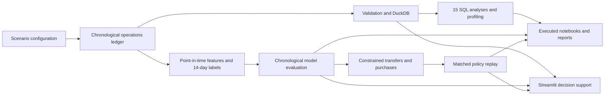
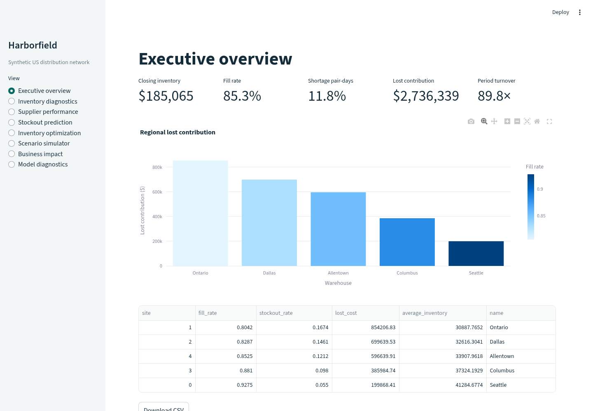
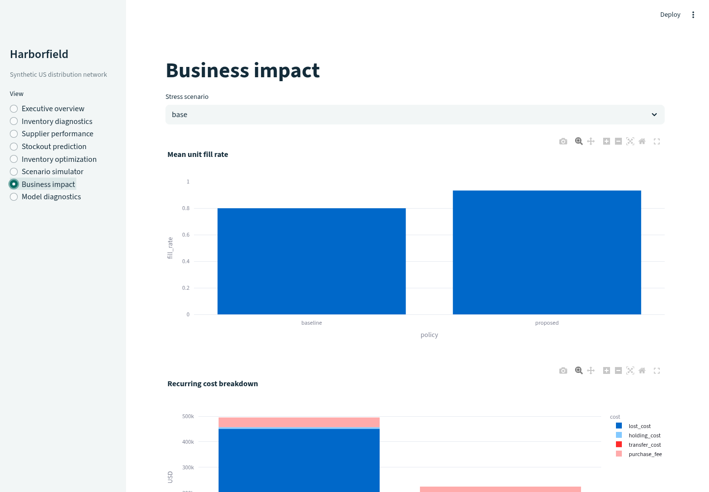

# Multi-Echelon Inventory Risk Intelligence & Optimization

Harborfield Consumer Goods is a fictional US manufacturer with five regional distribution centers. This project reconstructs how local stockouts occur despite inventory elsewhere in the network, identifies the exposure in SQL, predicts shortages 14 days ahead, and tests inventory decisions under matched demand and disruption scenarios.

## Results from the default run

| Measure | Observed synthetic result |
|---|---:|
| Historical coverage | 548 days, 150 SKUs, 25 suppliers, 411,000 warehouse-SKU-days |
| Historical fill rate | 85.27% |
| Shortage pair-days with enough closing inventory elsewhere | 99.0% |
| Selected LightGBM held-out average precision | 0.925 |
| Rules-based held-out average precision | 0.895 |
| Nominal fill rate, baseline → proposed | 79.94% → 93.24% |
| Nominal recurring cost, baseline → proposed | $495,607 → $223,980 |
| Nominal average working capital, baseline → proposed | $156,938 → $286,602 |

The results reflect simulated operations. The purchase-only ML control achieved slightly higher fill and lower recurring cost than the full policy, with higher purchase spend. Donor availability measures concurrent closing balances and overstates dispatchable inventory. [Executive business impact report](reports/03_business_impact_report.md)

The audit checks experiment robustness, model validity, terminal inventory and capital requirements. [Critical validation report](reports/04_critical_validation_report.md)

## Architecture



## Method and deliverables

- The business definition specifies stakeholders, hypotheses, costs and service KPIs. [Business problem](docs/01_business_problem.md)
- The generator simulates demand seasonality, promotions, correlated shocks, supplier delays, lane delays and inventory transfers. Capacity reserves committed arrivals. The relational model includes a daily ledger, orders, receipts, lane/SKU transfers, and stockout episodes. [Data model and ER diagram](docs/02_data_dictionary.md) · [Synthetic methodology](docs/03_synthetic_data_methodology.md)
- SQL covers warehouse and SKU performance, ABC/XYZ segmentation, lead-time variability, turnover, donor stock, lane costs and prioritization. [Queries](sql/) · [Executed findings](docs/04_sql_analysis_findings.md)
- EDA compares region, seasonality, suppliers, utilization and cost concentration. A four-week moving-block bootstrap measures uncertainty in donor availability and supplier-level rank association is descriptive. [Executed notebooks](notebooks/) · [Exploratory report](reports/01_exploratory_analysis_report.md)
- Rules, logistic regression, Random Forest and tuned LightGBM forecast any shortage over days 1–14. Purged chronological splits protect cutoff dates. Validation average precision chooses the model and validation F1 chooses its threshold. Held-out artifacts include calibration, segment errors, intervention-capacity metrics and permutation importance. [Model evaluation](reports/02_model_evaluation.md)
- The inventory engine ranks marginal transfer and purchase opportunities under capacity, transit, donor reserves and per-order bounds. The experiment compares a fixed reorder baseline and the risk-aware policy across three seeds and seven cases, with two additional nominal controls. [Optimization methodology](docs/05_optimization_methodology.md) · [Business impact](reports/03_business_impact_report.md)
- Portfolio material covers the path from the business problem to operational tradeoffs. [Case study](docs/06_project_case_study.md) · [Résumé and interview notes](docs/07_resume_and_interview_summary.md)

## Screenshots





## Run locally

Use Python 3.11 or later. LightGBM requires an OpenMP runtime such as `libgomp1` on Debian or `libomp` on macOS.

```bash
python -m venv .venv
source .venv/bin/activate
python -m pip install -e '.[dev]'
export OPENBLAS_NUM_THREADS=2 OMP_NUM_THREADS=2
python -m scripts.run
python -m scripts.analyze
pytest -q
python -m streamlit run app/Home.py
```

The first command-line stage builds data, DuckDB, SQL CSVs, held-out predictions, a serialized model, policy recommendations and replay outputs in `artifacts/`. The next stage executes the five notebooks and refreshes the reports and figures. Run commands from the repository root. Load Joblib files only from a trusted run.

To inspect the warehouse and execute EDA before training, run `python -m scripts.run --stage warehouse`, `python -m scripts.analyze --eda-only`, and `python -m scripts.run --stage decisions`. Then run the full analysis command above.

For a smaller CI run, use `python -m scripts.run --quick --output artifacts/quick`, then `python -m scripts.analyze --quick` and `HARBORFIELD_ARTIFACTS=artifacts/quick pytest -q`. The quick mode reduces SKU count, training history and replay replications. Its generated notebooks and reports stay under `artifacts/quick/`.

## Container deployment

```bash
docker build -t harborfield .
docker run --rm -p 8501:8501 harborfield
```

The image generates its own full artifact set and serves Streamlit on port 8501. In a managed network with a trusted organization CA, the build can receive the bundle via `docker build --secret id=build_ca,src=/path/to/ca-bundle.pem -t harborfield .`. The mount is scoped to dependency installation. GitHub Actions runs the reduced pipeline, notebooks and tests on pushes and pull requests.

## Limitations

The fictional network uses single sourcing, unit-based capacity, lost rather than deferred demand, and no pallet or truck constraints. Three replay seeds provide descriptive ranges. The short replay and absence of a terminal pipeline valuation affect economic comparisons. The heuristic uses a donor service buffer and does not enforce a network-wide fill-rate target. A real deployment needs reconciled commercial data, variable item dimensions, audited costs, service constraints and a shadow pilot with a working-capital budget.
