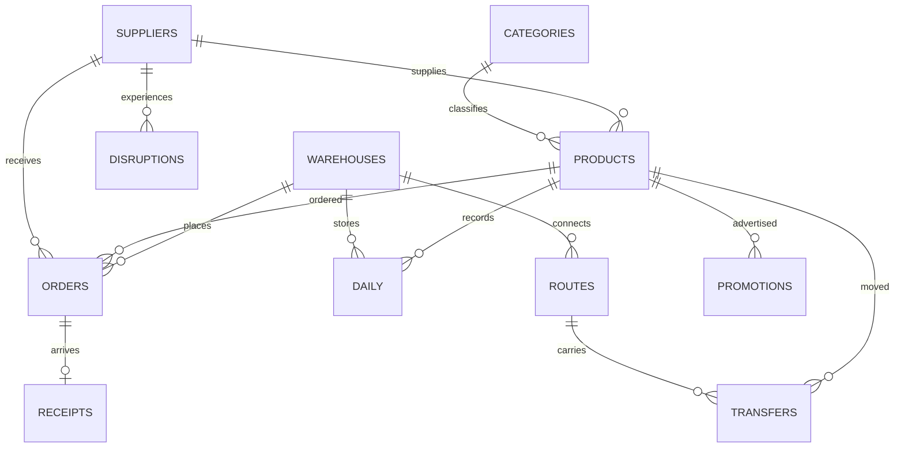

# DuckDB data dictionary

Identifiers are zero-based integers. Dates are timestamps on calendar-day boundaries. Quantities are units and financial amounts are synthetic USD. Tables have primary keys, foreign keys where applicable, and required fields.

| Table | Grain and key | Fields and interpretation |
|---|---|---|
| categories | category | Display name |
| warehouses | site | Regional name and unit capacity |
| suppliers | supplier | Promised lead time in days and synthetic reliability parameter |
| products | sku | Category, supplier, standard cost, daily holding cost, lost contribution penalty, and generator parameters |
| routes | source, destination | Promised transit days and unit freight |
| daily | date, site, sku | Opening/closing stock, received, inbound, outbound, purchased and pending units, demand, fulfilled and lost demand, position, pre-order stock/pending, open PO units and units due within seven days by promise, trailing demand mean, SD and shortage rate, observed supplier OTD/SD, tomorrow’s scheduled promotion, realized disruption used only for reporting, daily economic fields |
| orders | order_id | Site, SKU, supplier, order date, promised date, units |
| receipts | order_id | Observed date, units, actual order-to-receipt lead time |
| transfers | transfer_id | Lane, SKU, units, shipped date, promised arrival, realized arrival schedule and freight. Replay rows include in-transit transfers at cutoff |
| promotions | date, sku | Planned promotional flag |
| disruptions | date, supplier | Realized disruption flag |

Derived views expose supplier-to-SKU relationships, demand, fulfillment, the supplier lead-time history, stockout episodes and an inventory transaction ledger. The transaction ledger shows absolute units and direction via movement type. Orders with no receipt remain open at cutoff. The daily row records decisions and outcomes. The pre-order columns and trailing observations define the scoring timestamp.

