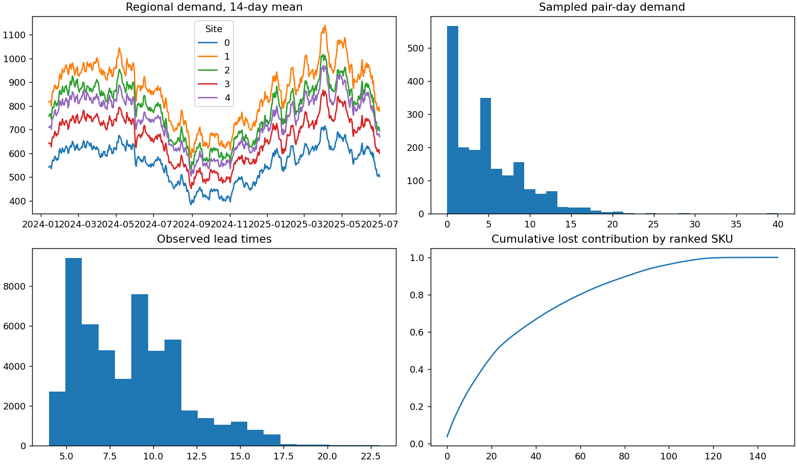

# Exploratory analysis

The historical network filled **85.27%** of requested units. Its 48,309 shortage pair-days produced $2,736,339 in simulated lost contribution. Site 1 led regional loss at $854,207, and SKU 97 led product loss. The 15 most exposed SKUs accounted for 36.8% of loss.

99.0% of shortage pair-days had enough closing stock elsewhere to cover the observed shortage. The four-week moving-block 95% interval was 98.7%–99.2%. This supports investigating rebalancing. Dispatch lead time and donor safety stock reduce the actionable share.

Supplier 22 had 54.8% on-time receipts. Supplier-level Spearman correlation between late receipts and shortage frequency was 0.64 across 25 suppliers. This descriptive estimate is confounded by supplier product mix and covers completed receipts. It cannot establish a supplier-delay effect.

Demand varies by region and over time. Coverage and recent shortfalls warrant point-in-time prediction. The replay measures whether those predictions translate to better decisions.

