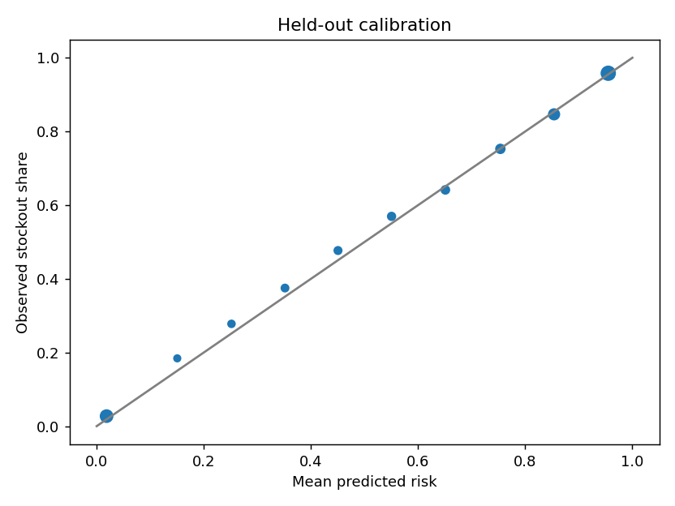
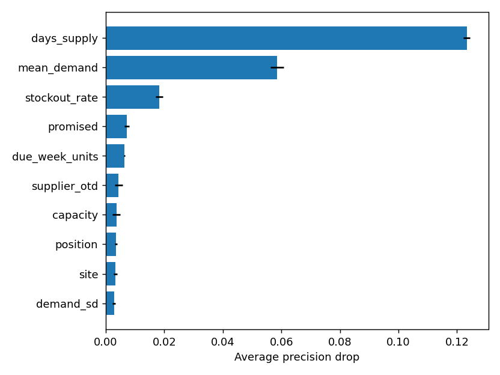

# Model evaluation

**lightgbm_31** led validation average precision. Its held-out prevalence was 58.48% across 72,000 eligible observations. The validation F1 threshold was 0.440. Test precision was 0.812, recall 0.910, and the confusion counts were TN 21,058, FP 8,839, FN 3,807, TP 38,296.

| Model | Validation AP | Test AP | ROC AUC | F1 | Brier | Precision at 5% | Recall at 5% |
|---|---:|---:|---:|---:|---:|---:|---:|
| rules | 0.834 | 0.895 | 0.881 | 0.849 | 0.173 | 0.952 | 0.081 |
| logistic | 0.879 | 0.925 | 0.906 | 0.859 | 0.120 | 0.994 | 0.085 |
| forest | 0.876 | 0.924 | 0.905 | 0.859 | 0.120 | 0.991 | 0.085 |
| lightgbm_15 | 0.883 | 0.924 | 0.905 | 0.860 | 0.120 | 0.990 | 0.085 |
| lightgbm_31 | 0.883 | 0.925 | 0.905 | 0.858 | 0.120 | 0.993 | 0.085 |

Scores forecast any shortage in the next 14 calendar days. The model uses 28 days of historical operations, completed supplier receipts, and tomorrow’s known promotion plan. Model comparison uses average precision as PR-AUC convention. Calibration and sliced errors are available in the generated CSVs and notebooks. Scores may shift once a new policy changes on-hand and pipeline distributions.

